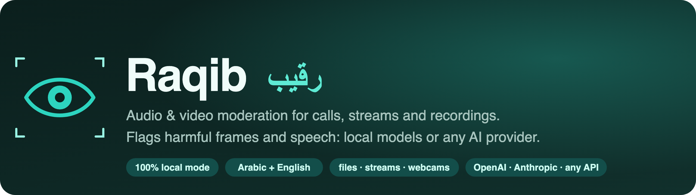
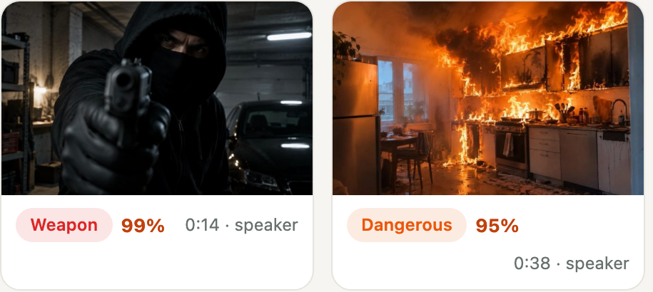
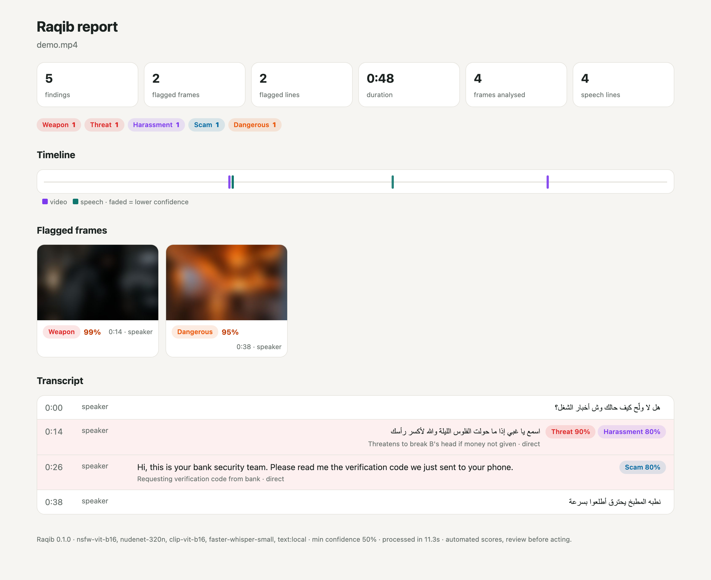
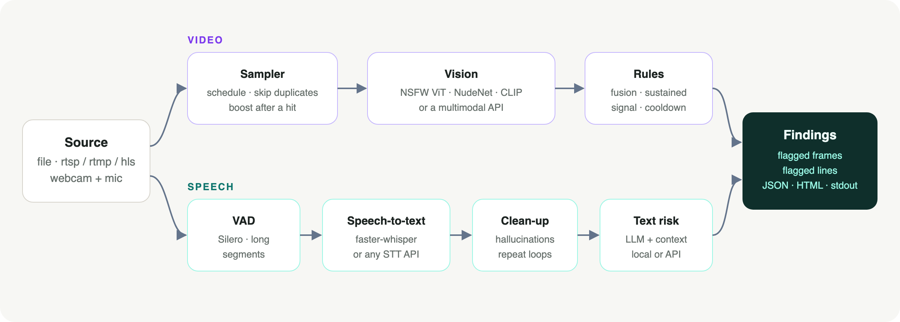

<p align="center">
  
</p>

<p align="center">
  <a href="LICENSE"></a>
  
  
  
</p>

**Raqib** (رقيب, *the watchful one*) watches video calls, live streams and recordings and tells you **which
frames and which sentences are harmful**: nudity, sexual content, weapons, violence, dangerous scenes and
self-harm in the picture; insults, threats, hate, sexual solicitation, extortion, grooming, scams and self-harm
in the speech.

It runs **entirely on your machine** with open models (no API key, nothing leaves the box), or you can point
any stage at an **AI provider** (OpenAI, Anthropic, Groq, OpenRouter, Gemini, a local Ollama …). Mix and match:
local vision + provider speech, or the other way round.

It was built for real calls, where most of the hard problems are not the models but everything around
them: dark webcam frames, phone-quality audio, Gulf Arabic dialects, speech-to-text hallucinations, jokes that
sound like threats. The defaults in this repo come from that work.

---

## What it catches

Raqib keeps the **frames it flags** and the **lines it flags**, with the time, the category and a confidence:

<p align="center"></p>

Every run writes a `report.json` and a self-contained `report.html`. Flagged frames are **blurred by default**
in the report (click to reveal); the originals are saved next to it.

<p align="center"></p>

<sub>The report above is the bundled demo (`scripts/make_demo.py`): AI-generated stills with synthetic speech.
A 48-second clip, analysed fully offline on a laptop CPU in about 11 seconds. Nothing flagged in the small talk; the
staged pistol, the insult + threat, the fake "bank" asking for an SMS code and the kitchen fire are all caught.</sub>

| Picture | Speech |
|---|---|
| `nudity`, `sexual_act`, `weapon`, `violence`, `dangerous`, `self_harm` | `harassment`, `abuse`, `threat`, `hate`, `sexual_solicitation`, `extortion`, `grooming`, `scam`, `self_harm` |

## Quick start

```bash
git clone https://github.com/XFAISAL/raqib && cd raqib
python -m venv .venv && source .venv/bin/activate
pip install -e .                 # add [gpu] for CUDA: pip install -e ".[gpu]"

raqib models download            # vision models + faster-whisper "small" (~1 GB, once)
raqib analyze call.mp4           # → reports/call/report.html
```

Speech-to-text works out of the box. To also **judge** what was said, give Raqib a language model, either local
(below) or a provider. Without one it still transcribes and flags the picture.

### Fully local (no API, nothing leaves your machine)

```bash
raqib models download --llm qwen3-4b      # + a 2.5 GB instruct model (GGUF, Apache-2.0)
llama-server -m ~/.raqib/models/llm/Qwen3-4B-Instruct-2507-Q4_K_M.gguf --port 8080 -c 4096   # llama.cpp
raqib analyze call.mp4
```

Any OpenAI-compatible server works for the local text stage (`text.local.base_url`): llama.cpp,
Ollama (`http://127.0.0.1:11434/v1`), vLLM, LM Studio.

### With an AI provider

```bash
export OPENAI_API_KEY=...
raqib analyze call.mp4 --text provider                                   # gpt-4o-mini judges the speech

export ANTHROPIC_API_KEY=...
raqib analyze call.mp4 --text provider --set text.provider.kind=anthropic \
  --set text.provider.model=claude-haiku-5-5 --set text.provider.api_key_env=ANTHROPIC_API_KEY

export GROQ_API_KEY=...
raqib analyze call.mp4 --stt provider --set stt.provider.base_url=https://api.groq.com/openai/v1 \
  --set stt.provider.model=whisper-large-v3 --set stt.provider.api_key_env=GROQ_API_KEY
```

Keys are only read from environment variables, never from config files.

## Usage

```bash
raqib analyze talk.mp4                         # one file
raqib analyze alice=alice.webm bob=bob.webm    # one recording per participant → labelled speakers,
                                               # each line judged with the whole conversation as context
raqib watch rtsp://camera/stream               # live: findings stream out as JSON lines
raqib watch "0:0" --format avfoundation        # macOS webcam + microphone
raqib watch /dev/video0 --format v4l2          # Linux webcam
raqib image photo.jpg                          # score images
raqib text "line to check" --context "what the other person said before"
raqib models status
```

Useful flags: `--vision/--stt/--text local|provider|off`, `--min-confidence 0.6`, `--whisper medium`,
`--lang ar,en`, `--no-blur`, `--set any.setting=value`, `-c raqib.yaml`.

Live output (`raqib watch`):

```json
{"kind": "weapon", "modality": "video", "t": 14.0, "confidence": 0.9894, "frame": "frames/000014_weapon_8f3687.jpg", ...}
{"kind": "threat", "modality": "audio", "t": 14.24, "confidence": 0.9, "text": "اسمع يا غبي إذا ما حولت الفلوس الليلة والله لأكسر رأسك", "act": "direct", ...}
```

### Python

```python
import raqib

result = raqib.analyze({"alice": "alice.webm", "bob": "bob.webm"}, out="reports/call-42")
for f in result["findings"]:
    print(f"{f['t']:6.1f}s  {f['kind']:<12} {f['confidence']:.0%}  {f.get('frame') or f.get('text')}")
```

For your own media pipeline (WebRTC, LiveKit, a game server …), feed frames and audio straight into
`raqib.pipeline.Analyzer` (`feed_video`, `feed_audio`, `assess`) and handle findings in `on_finding`.

## How it works

<p align="center"></p>

**Picture.** Frames are sampled on a schedule (every 2 s for the first minute, then every 5 s), near-identical
frames are skipped, and sampling speeds up again for a minute after anything is found. Each frame goes through
three small ONNX models:

- an **NSFW classifier** (ViT-B/16) drives the nudity score,
- **NudeNet** confirms it with exposed body parts (a shirtless man, swimwear or a skin-coloured wall alone
  does not trigger),
- **CLIP** zero-shot prompt groups score weapons, violence, dangerous scenes and self-harm against a deliberately
  broad "normal life" group (kitchen knives, toy guns, campfires, TV screens, boxing on TV …) that was tuned on
  real false positives.

A **sustained-signal rule** catches explicit footage the classifier misses, typically a screen filmed with a
phone: one CLIP frame is too noisy, but a strong signal on most frames for 30 s is not.

**Speech.** Silero VAD cuts speech into deliberately **long segments** (2 s hang, 0.8 s padding, up to 12 s).
Short segments looked tidy but made Arabic insults come out as unrelated words. Then **faster-whisper**
transcribes, and a clean-up step removes what speech-to-text invents on silence and noise ("thanks for watching",
subtitle credits, «موسيقى» tags) and collapses repetition loops.

**Meaning.** A language model reads each new line **with the conversation before it** and scores only the new
line. It labels the speech act (direct, quoted, reported, joking, media, hypothetical) and non-direct speech is
discounted, so *"my brother said he'd kill me"* is not a threat by the speaker. There are no keyword lists: the
model judges meaning, in any dialect.

## Configuration

Copy [`examples/raqib.yaml`](examples/raqib.yaml) to `./raqib.yaml` or `~/.raqib/config.yaml`. Every setting can
also be set with `--set key=value` or an environment variable (`RAQIB_SAMPLING__INTERVAL=3`).

| Setting | Default | |
|---|---|---|
| `min_confidence` | `0.5` | findings below this are not reported |
| `kinds` | all | only report these categories |
| `vision.backend` / `stt.backend` / `text.backend` | `local` | `local`, `provider` or `off` |
| `vision.device`, `stt.device` | `auto` | CUDA when available, else CPU (int8 models) |
| `sampling.interval` | `5` | seconds between analysed frames (2 s for the first minute and after a hit) |
| `stt.model` | `small` | faster-whisper size; `medium` or `large-v3` for noisy Arabic |
| `stt.languages` | `ar, en` | language ID is restricted to these |
| `output.blur_frames` | `true` | blur flagged frames in the HTML report |
| `output.save_audio` | `false` | also keep flagged speech clips as WAV |

## Models

Downloaded by `raqib models download` into `~/.raqib/models` (or `models_dir`). Each keeps its own license.

| Stage | Model | License |
|---|---|---|
| Nudity | [Falconsai NSFW ViT-B/16](https://huggingface.co/Falconsai/nsfw_image_detection) ([ONNX](https://huggingface.co/onnx-community/nsfw_image_detection-ONNX)) | Apache-2.0 |
| Body parts | [NudeNet 320n](https://github.com/notAI-tech/NudeNet) | AGPL-3.0 |
| Zero-shot scenes | [CLIP ViT-B/16](https://huggingface.co/openai/clip-vit-base-patch16) ([ONNX](https://huggingface.co/Xenova/clip-vit-base-patch16)) | MIT |
| Voice activity | [Silero VAD v6](https://github.com/snakers4/silero-vad) (bundled with faster-whisper) | MIT |
| Speech-to-text | [faster-whisper](https://github.com/SYSTRAN/faster-whisper) / Whisper | MIT |
| Text risk (optional) | [Qwen3-4B-Instruct-2507 GGUF](https://huggingface.co/unsloth/Qwen3-4B-Instruct-2507-GGUF) | Apache-2.0 |

NudeNet's weights are AGPL-3.0. If that does not fit your product, turn it off (`vision.nudenet: false`);
nudity is then scored by the classifier and CLIP alone.

## Accuracy, limits, and how to use it responsibly

- Scores are **signals for a human reviewer**, not verdicts. Review before you act on anyone.
- CLIP prompts are good at obvious scenes and weak at small details: hand gestures, a weapon at the edge of a
  dark frame, a toy that looks real.
- Dark, close-up webcam frames are the classic nudity false positive; NudeNet corroboration is what keeps
  them down. Keep it on if you can.
- Speech is only as good as the transcript. Use a bigger Whisper (`medium`, `large-v3`) for noisy Arabic
  calls, and a bigger text model for subtle cases. A 4B model sometimes misses "reported" speech.
- **Privacy:** recording and analysing calls is regulated in most places. Tell people, get consent, keep only
  what you need. Raqib keeps flagged frames and transcript lines in the report folder, holds everything else in
  memory only, and never sends media anywhere unless you choose a provider backend.

## Reproduce the demo

```bash
python scripts/make_demo.py demo/demo.mp4     # macOS (uses the Majed and Samantha voices)
raqib analyze demo/demo.mp4 -o demo/reports
```

## Development

```bash
pip install -e ".[dev]"
pytest -q
```

Ideas welcome: more languages for the hallucination filter, better zero-shot prompts, a hand-gesture model,
a WebRTC / LiveKit connector. Please open an issue first for anything large.

## License

MIT © 2026 Faisal Alamoudi. Model weights are under their own licenses (see [Models](#models)).
